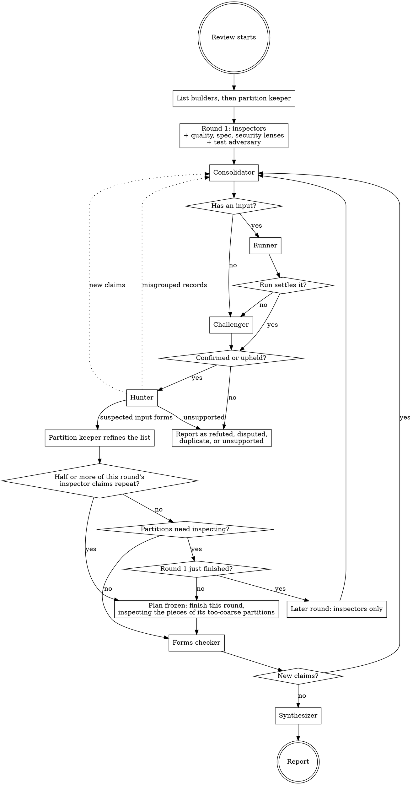

# Deep Review

A deep review runs only when the user asks for a "deep", "thorough", or "exhaustive" review (`SKILL.md`, Step 0).
It does everything a standard review does, and adds four things:

- the **partition list**: list builders and the partition keeper build it, inspectors check each partition's input forms against the code in rounds, and a forms checker checks the forms against the tests (`partition-discovery.md`);
- a **runner**, which writes and runs a probe for each claim that has an input;
- a **hunter** for each failure mode with a confirmed defect, which looks for the other places that have the same fault;
- **rounds**: a second round inspects what the first round's keeper added to the list.

It costs several times the dispatches of a standard review.

`review-dispatch.md` holds the details this file points to: how to dispatch a role, what to gather first, the roles both reviews share, and the report.
Read it before the first dispatch.
Without a subagent dispatch tool, run each role yourself, in order (see "Without a Subagent Tool").

## Flow



The steps below follow the chart.
A round ends when every record it produced, including those from its hunters, has a verdict and the keeper has refined the list; `review_state.py start-round` refuses to start the next round before then.

## Before Step A

Do the prerequisites in `review-dispatch.md` ("Prerequisites Before Dispatch"), and start the review with `start-review --depth deep`.

After Step A, and before Step B dispatches anything, state the coverage, the dispatch count, and the packet's size (`partition-discovery.md` § 5, and `packet_tokens` from the packet script).
Example: "First review of this component: all 26 partitions, the lenses and the test adversary, then a consolidator, runner, and challenger per judging batch, a hunter per failure mode, and a synthesizer; about 45 dispatches; the packet is about 24,000 tokens."
Do not offer a smaller scope or another depth: a review that skips work leaves a later review to find what it skipped, and the review type is the user's call, not a suggestion.

## What the Dispatch Cycle Adds in a Deep Review

The dispatch cycle is in `review-dispatch.md`.
In a deep review:

- `dispatch` with no role gives each runner at most three records.
- `dispatch` with no role does not register list builders, because grouping the changed files into components is your decision, and it does not start a round; `next` names those steps.
- `submit` also refuses an inspector's or a forms checker's output that leaves an input form without a status.
- `start-round` is safe to repeat, and a list builder's `dispatch` repeated with other paths is refused and names the open dispatch and its paths.
- `dispatch <role>` runs a role out of the order `next` gives only where the procedure allows it: it refuses a forms checker while the partition loop has work left, and an inspector after the keeper refined the list in this round (run `start-round` first).
- `start-round` also refuses once the synthesizer is dispatched.
- `status` also shows `round`, `convergence`, and `plan_frozen`, and its `pending` lists `inspect`, `run`, `hunt`, `refine`, and `check_forms` beside the keys both reviews use.

## Step A — Build the Partition List

Dispatch one list builder per component (`partition-discovery.md` § 1): `dispatch list-builder --component <name> --paths <file> <file>...`, with the component's changed files; it refuses a path the packet does not change.
Then dispatch the partition keeper (`dispatch keeper`); its input holds the saved partitions, the partitions waiting for inspection, and the builders' proposals, and its `submit` saves the list.

## Step B — Round 1: Inspectors, Lenses, and Test Adversary

Dispatch one inspector per entry in `pending.inspect` (`partition-discovery.md` § 2), in batches up to the concurrency limit, until `pending.inspect` is empty; at the same time when the harness allows it, dispatch the lenses and the test adversary (`review-dispatch.md`, "Lenses and Test Adversary").
`dispatch` with no role registers all of them.
Do not add prior findings, prior verdicts, edges to probe, or notes from earlier runs to any inspector or lens prompt.
An inspector's `dispatch` records the content of its partition's files on disk, and its `submit` records the status it reports for each input form.

Inspectors search by domain feature; the quality lens reads the diff line by line for defects that do not belong to a feature.
The security lens is still dispatched: partitions do not replace it, because it covers dependency, logging, and configuration changes that a partition does not reach.
The lenses and the test adversary run once, in round 1; `start-round` refuses until each has run.
Their claims go to the judges with the inspectors' claims, so their confirmed defects get hunters and refine the list before round 2.

Later rounds dispatch inspectors only.

## Step C — Judge

Every claim goes through the judges, whichever finder wrote it.
Judge in batches: the round's first batch is everything round 1's roles returned; each hunter's new claims, and the forms checker's, form another batch.
A record that a hunter listed in `misgrouped` (Step D) joins the consolidator's next batch; it keeps its run and its challenge, so the runner and the challenger do not get it again.

1. **Consolidator** (`review-dispatch.md`, "Consolidator").
   A record that a hunter listed in `misgrouped` comes with that entry: the failure mode it left, and the hunter's reason.
   The consolidator places it by the same test, as a duplicate or in a failure mode; `submit` refuses the failure mode it left, and a duplicate of a record in that failure mode.
   The consolidator also restates the description of the failure mode the record left, so that it fits the records that stayed.
   `submit` replaces that description, and keeps the description of every other existing failure mode.
2. **Runner** (`dispatch runner`, with `--records <ids>` for a subset), for `pending.run`: every grouped record with an input and without a run, duplicates included.
   Give one runner a few records, as `dispatch` with no role does: a runner given many returns before it finishes them, so `next` names `dispatch` with no role for this step and for the challenger's.
   `--records` takes only ids that wait for the role or that an open dispatch of the role holds; `dispatch` refuses any other id and names it.
   For each, it writes the input as a probe script in a fresh directory under `$TMPDIR`, runs it with the project's own runner or interpreter, checks that the probe reached the code path the claim names, and tests the expected result in the probe.
   The probe checks the result as a test of the expected result would, so an error that is a subclass of the expected error type meets it; the runner does not decide from the claim's predicted result or from a printed name.
   It never deletes files, and a result is only what a run printed.
   The test adversary's and the forms checker's own runs count; the runner does not repeat them.
   When a duplicate's run and its primary's run disagree, `submit` splits the duplicate back out into a record of its own, with its primary's failure mode.
   The runner's verdicts:
   - `confirmed`: the probe reached the path and the result does not meet the expected result.
   - `refuted`: the probe reached the path and the result meets it.
   - `not runnable`: the probe cannot meet its preconditions (a live service, network, credentials, an interleaving one run cannot force, a sandbox restriction), or it did not reach the path.
     Unfinished work is not `not runnable`.
3. **Challenger** (`review-dispatch.md`, "Challenger"), for every record a run could not settle.
   It sees only what a run left open.

A `disputed` finding does not get a hunter unless the user rules it upheld; a finding ruled upheld then gets its hunter.

## Step D — Hunt

Dispatch one hunter per failure mode in `pending.hunt` (`dispatch hunter --failure-mode "<name>"`): each failure mode that has confirmed or upheld records and that a hunter has not searched in this round.
A failure mode gets one hunter in a round, and one more when the first left sites `not checked`, so that hunting ends.
A record that a hunter filed is judged and reported like any other, but does not start a hunt: its hunter already searched the change for that kind of defect, and sent the suspected input forms to the keeper.
A record confirmed or upheld in a failure mode after its hunter was dispatched does not get a hunter of its own: `pending.refine` lists it, and its input form goes to the partition keeper as a suspected input form, so inspectors check it in the next round.
In round 2, a failure mode that round 1 hunted gets a hunter for its new records; that hunter's input holds the earlier hunt (`earlier_hunt`: its `expected`, its `searched`, and its sites), so it checks the new records against the earlier rule and does not decide the earlier sites again.

The hunter first checks each record's expected result against the source its claim cites; a record whose source does not support it becomes `unsupported` and is dropped before it changes the list.
A record whose claim does not cite a source does not need this check: a run cannot settle it, so the challenger already judged its expected result.
When the source does not support any checked record, the hunter stops there.
Otherwise it finds the other places that have the same fault:

1. It writes `expected`: the records' expected result, restated as one rule that must hold at every place in a set of places, without a file, function, or variable name.
   It generalizes to the broadest rule for which it can name where every such place is defined.
   When a record breaks a different rule than the others, the hunter does not widen `expected` to cover it: it writes `expected` for the largest group of records that break one rule, and lists each other record in `misgrouped` with the reason.
2. It writes `searched`: what produces every such place.
   Each entry names a table, a set of definitions, or a search, and where it is.
   For a documentation defect, the entries are each behavior the change altered, and every place the documents name it.
   The records are examples: the hunter builds its list from `searched`, not from the records or their inputs, so its input holds each record's claim and not its run.
3. It lists every member in `sites` and decides each one by reading its code: `handled` (the reason cites the line that keeps the rule), `claims` (the site breaks the rule), or `not checked`.
   A passing test is not evidence that a site is handled.
   The list reproduces the places already known: the site of each supported record that is not in `misgrouped` is in it, with the site text copied exactly.
4. It reports each site that breaks `expected`, other than the records' sites, as a claim, and names every plausible contributing cause of the records as a suspected input form.

The review's scope sets what a hunter searches.
A review of a change (scopes `staged`, `branch`, `worktree`) searches the change and the code that calls it or that it calls.
A baseline review of a whole codebase searches all of it.

`submit` refuses a hunt that searched and left `expected`, `searched`, or `sites` empty.
It also refuses a claim whose site is not in `sites` with status `claims`, a site with status `claims` that neither a claim nor a given record names, and a list without a supported record's site.
A record in `misgrouped` is left out of both checks: its site need not be in `sites`, and it does not stand for a site with status `claims`.
When a hunter leaves sites `not checked`, `pending.hunt` lists the failure mode again, without records, and one more hunter in the same round decides those sites.
Its input holds the first hunter's `expected` and `searched`, and only the unchecked sites; it does not search for more.
The sites the second hunter leaves `not checked` do not start a third hunter; the report lists them.

`submit` takes each record in `misgrouped` out of its failure mode.
The record is then without a grouping again, so `pending.consolidate` lists it, and the consolidator places it (Step C).
It keeps its run, its challenge, and its ruling, and its duplicates stay its duplicates.
The record was not given to a hunter for its new failure mode.
When a hunter has not searched that failure mode in this round, its hunter gets the record.
When one has, `pending.refine` lists the record, as it lists a record confirmed after the hunt.
A record moves once in a review, so that regrouping ends.
When the hunter of its new failure mode lists it in `misgrouped` too, it stays in that failure mode, and the report says under the finding that a hunt did not cover it.
`submit` refuses a `misgrouped` list that names a record the hunter was not given, a record its `expectations` mark unsupported, a record twice, or every supported record; for the last, the hunter writes `expected` for the largest group of records that break one rule.
A hunter given `earlier_hunt` may list every supported record, because the rule stays the earlier hunt's; it then leaves `searched` and `sites` empty.
It also refuses any `misgrouped` entry from the hunter that decides only unchecked sites.

A hunter's new claims go to the judges (Step C); its suspected input forms go to the partition keeper, each with the failure mode it may trigger.
The consolidator's input gives each hunted failure mode its `expected`, its `searched`, and its sites with their statuses.
The synthesizer's input adds each site's reason, and the report states what each hunt searched and lists the sites left `not checked`.

## Step E — Refine and Repeat

When `pending.refine` lists dispatches or records, dispatch the partition keeper (`partition-discovery.md` § 3); its input holds the round's suspected input forms (the hunters', and those of records confirmed in or moved into a failure mode after its hunt) and the partitions inspectors reported `too_coarse`, and its `submit` saves the list.
Then apply the convergence check (`partition-discovery.md` § 4): once a round has inspected every partition it started with and has converged, `status` shows `plan_frozen: true`, and a further round does not start.
The review then finishes that round's own work: it judges and hunts every record, the keeper splits the partitions the round reported too coarse, and inspectors check the pieces; `pending.inspect` lists only those pieces.
The keeper still saves the hunters' suspected input forms, as additions to the plan for later reviews; the report lists them with the other changes to the list.
When that work is done, go on to the forms checker (Step F).
If the plan is not frozen and `pending.inspect` is empty, go on to the forms checker too.
Otherwise run `review_state.py start-round --review <review_id>` and run the next round, inspectors only, on the partitions in `pending.inspect`; each inspector's input holds only its partition's pending input forms.
A deep review inspects in at most two rounds.
When round 2 is inspected, the plan freezes as it does on convergence: the review finishes this round's work, and later reviews inspect the rest.
Do not ask the user for a third round; `start-round` refuses one.

## Step F — Forms Checker

When the loop stops, dispatch the forms checker (`dispatch forms-checker`).
Its input holds the input forms of the partitions the change touches that a forms checker has not checked (`pending.check_forms`), and each of those partitions' feature and paths.
It lists the tests that exercise each form, and for each form that a test does not exercise, runs a distinguishing input to tell a test gap from a code defect.
Its claims go to the judges.
If its defects reopen the loop, dispatch it again afterward; it gets only the forms added since.

## Step G — Synthesis and Report

Dispatch the synthesizer and present the report (`review-dispatch.md`, "Synthesis" and "Report").
In a deep review, the synthesizer's `dispatch` also refuses while any record waits for the runner or a hunter, the keeper has output to take, a partition this review owes waits for its inspector, or the forms checker has forms to check.

## Without a Subagent Tool

Run each role yourself, in the order of the steps (`review-dispatch.md`, "Without a Subagent Tool"), with two rules:

- In round 1, finish every partition inspection before any lens.
  Your own context is the leak, and round 1 is the only inspection that starts from the reference alone.
- Run the forms checker after every other finder; its claims still go to the judges and the hunters before the synthesizer.

## Dispatch Order

The consolidator dispatches once per judging batch, then the runners, then the challengers; one hunter per failure mode after judging, and one more for a failure mode whose hunter left sites `not checked`; the partition keeper after the round's hunters; the forms checker after the loop; the synthesizer last.

```text
Agent({
  description: "Inspect partition P3: here-documents feeding a pipeline",
  subagent_type: "general-purpose",
  model: "<small_model>",
  prompt: "Read the file <the inspector's prompt_path> in full and follow it exactly. It is your complete assignment.",
})
```

## Common Mistakes

`review-dispatch.md` lists the mistakes both reviews share.
A deep review adds these:

- **Refining the list in the orchestrator.**
  Only the partition keeper changes the list.
- **Seeding the partition list from the last review's findings.**
  Partitions come from the domain, the implementation's tables, the spec, and the diff's constructs (`partition-discovery.md` § 1).
- **Adding prior findings, edge lists, or notes to an inspector prompt.**
  The inspector then searches near the last defect, and each review finds one more failure mode instead of all of them.
  Dispatch each filled prompt unchanged, and do not add anything to the line that names it.
- **Sending a claim to a hunter before the judges.**
  A false cause then becomes an input form that every later review checks.
- **Letting the hunter add partitions.**
  Only the partition keeper changes the list, and a new partition needs an origin that names it; otherwise the list grows without end.
- **Skipping the security lens because the partitions cover the change.**
  It is always dispatched; partitions do not replace it.
- **Keeping a second ledger of rounds.**
  `status --review` is the record, and a copy can disagree with it.
